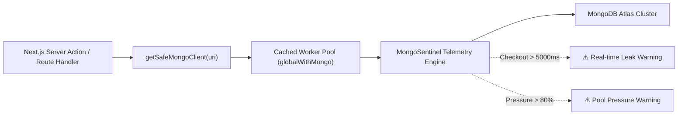

# mongo-next-sentinel 🛡️🍃

[](https://npmjs.com/package/mongo-next-sentinel)
[](https://www.typescriptlang.org/)
[](https://opensource.org/licenses/MIT)
[](https://www.mongodb.com/startups)

> **High-performance connection pool auditor and connection leak detector designed specifically for Next.js App Router (Server Actions & Route Handlers), AWS Lambda, and Serverless Edge runtimes.**

---

## ⚡ The Serverless MongoDB Dilemma

In traditional long-running Node.js servers (e.g. Express), a single `MongoClient` pool is instantiated once at startup and lives indefinitely.

In **Next.js App Router**:
1. **Server Actions & Route Handlers** run in transient, stateless serverless worker processes.
2. During **local development (`next dev`)**, Fast Refresh wipes module closures while keeping background Node runtimes alive, causing orphaned `MongoClient` instances to pile up.
3. In **production serverless deployments** (Vercel, AWS Lambda), naive client instantiation inside request handlers causes **connection storms** — rapidly exhausting MongoDB Atlas connection limits (`MongoServerSelectionError: connection pool exhausted`).
4. **Unhandled cursors & long-running queries** can hold pool sockets hostage without throwing visible errors until the entire cluster stalls.

`mongo-next-sentinel` eliminates this entire class of failures with zero runtime overhead.



---

## 🚀 Quickstart

### 1. Installation

```bash
npm install mongo-next-sentinel mongodb
# or
bun add mongo-next-sentinel mongodb
# or
pnpm add mongo-next-sentinel mongodb
```

### 2. Next.js App Router (`lib/mongodb.ts`)

```typescript
import { getSafeMongoClient } from 'mongo-next-sentinel';

const URI = process.env.MONGODB_URI!;

export const { clientPromise, sentinel } = getSafeMongoClient(URI, {
  clientOptions: {
    maxPoolSize: 10,
    minPoolSize: 1,
    maxIdleTimeMS: 30000,
  },
  sentinelConfig: {
    leakThresholdMs: 4000, // Warn if any query holds a socket > 4s
    onLeakDetected: (warning) => {
      console.error(`[LEAK ALERT] Connection #${warning.connectionId} checked out for ${warning.checkedOutDurationMs}ms`);
    },
  },
});
```

### 3. Use in Server Action (`app/actions.ts`)

```typescript
'use server';

import { clientPromise } from '@/lib/mongodb';

export async function createUser(formData: FormData) {
  const client = await clientPromise;
  const db = client.db('production');

  const result = await db.collection('users').insertOne({
    name: formData.get('name'),
    createdAt: new Date(),
  });

  return { id: result.insertedId.toString() };
}
```

---

## 🔍 Features

- **Zero-Config Next.js Fast Refresh Safe**: Automatically isolates client singletons in `globalThis` in development, preventing duplicate pool allocations across hot reload cycles.
- **Microsecond Pool Auditing**: Listens to native MongoDB Command & Connection Pool Monitoring (CMAP) events without intercepting queries or adding latency.
- **Active Connection Leak Detection**: Tracks every checked-out connection against a strict deadline. If unclosed streams or unexhausted cursors hog a socket, Sentinel emits actionable alerts before pool exhaustion occurs.
- **Peak Metrics & Pool Pressure**: Real-time observability over `totalCreated`, `totalClosed`, `currentActive`, `currentAvailable`, and `peakActive`.
- **Dual ESM & CommonJS**: Full compatibility across Node 18+, Node 20+, Node 22+, and Bun.

---

## 📊 Live Metrics API

You can inspect the state of your connection pool at any time (e.g. inside a Next.js Health Check Route `/api/health`):

```typescript
import { NextResponse } from 'next/server';
import { sentinel } from '@/lib/mongodb';

export async function GET() {
  const metrics = sentinel?.getMetrics();
  return NextResponse.json({
    status: 'healthy',
    pool: metrics,
  });
}
```

Example response:
```json
{
  "status": "healthy",
  "pool": {
    "totalCreated": 5,
    "totalClosed": 0,
    "currentActive": 1,
    "currentAvailable": 4,
    "peakActive": 3,
    "checkoutWaitCount": 12
  }
}
```

---

## 🛡️ License

MIT © [Daksh Rawat (Kukzze)](https://github.com/Kukzze)
Proud member of the **MongoDB for Startups** cohort.
